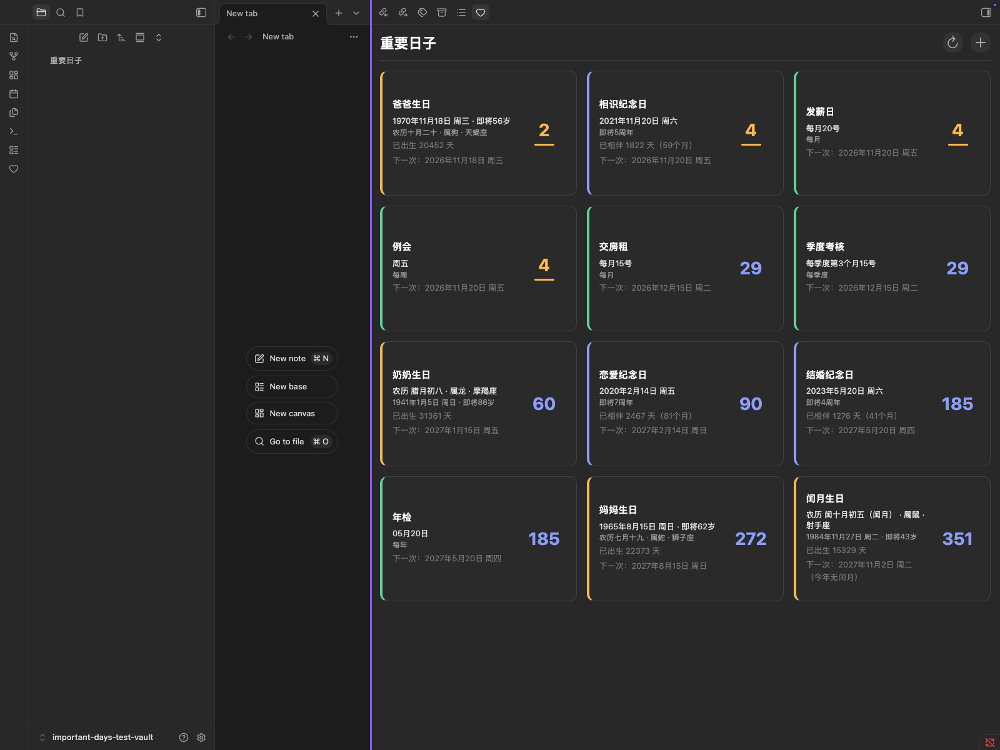
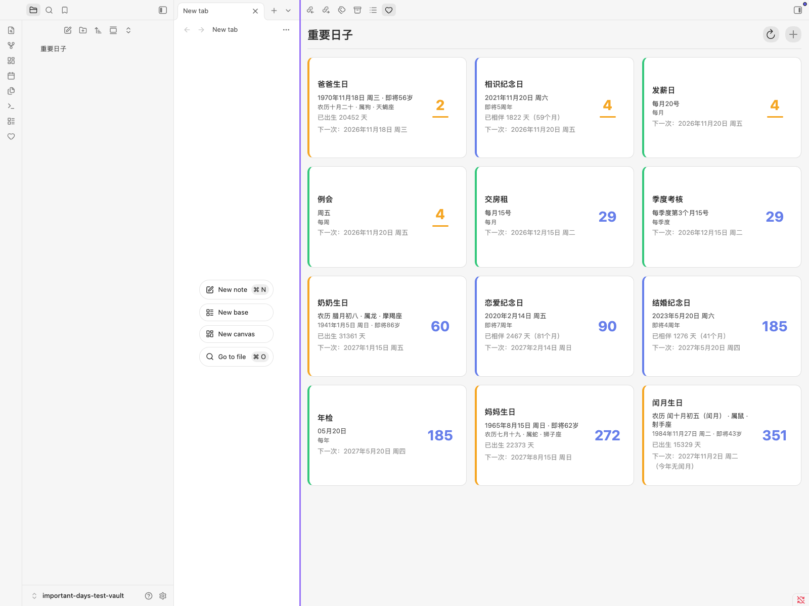
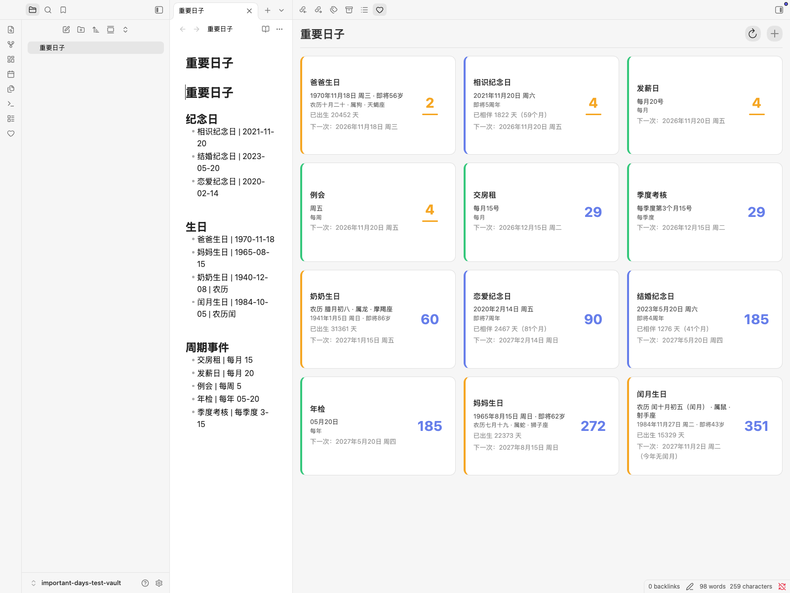
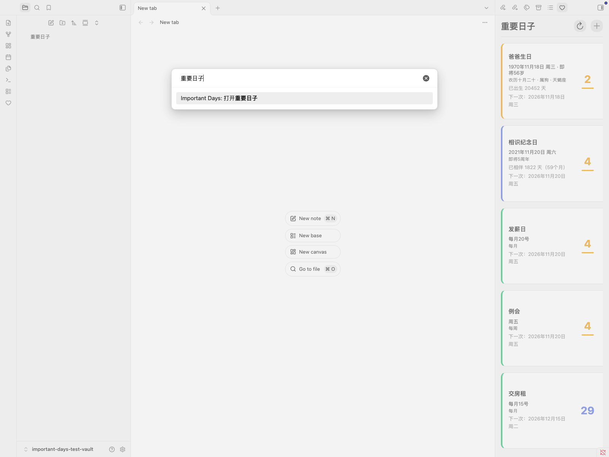
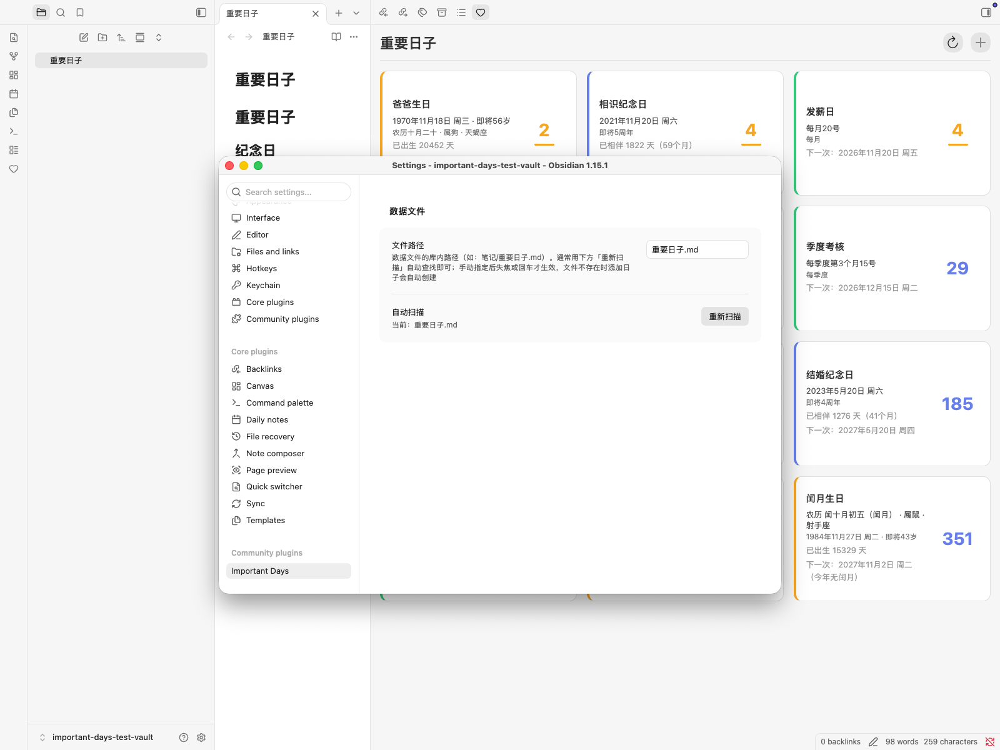

# 重要日子 (Important Days)

## 下载安装（小白版）

**最省事的一条路：直接在 Obsidian 里装。** 设置 → 第三方插件 → 浏览，搜索「Important Days」→ 安装 → 启用。插件进入官方社区目录后，之后的更新也在这个页面点一下就能拿到。

> 从社区目录安装时，客户端只逐个下载 Release 里的 `main.js`、`manifest.json`、`styles.css` 三份文件。这个插件完全不联网，也没有需要另行下载的数据文件——数据就是你自己库里的一个 Markdown 笔记。

**想手动装**（比如所在网络打不开社区插件浏览器）：

1. 打开本仓库的 [Releases 页面](https://github.com/duany2026/important-days/releases)，下载最新版本里的 `important-days-<版本号>.zip`
2. 解压，得到文件夹 `important-days`
3. 打开你的 Obsidian 笔记库文件夹，进入隐藏目录 `.obsidian/plugins/`（如果没见过这个目录：在 Obsidian 里点左下角仓库图标 →「在系统资源管理器中显示仓库」，进去就能看到 `.obsidian`）
4. 把解压出的 `important-days` 文件夹整个放进去，变成 `.obsidian/plugins/important-days/`（里面应有 `main.js`、`manifest.json`、`styles.css`）
5. 重启 Obsidian → 设置 → 第三方插件 → 关闭「受限模式」（旧版叫「安全模式」）→ 在已安装插件列表中启用「Important Days」（社区插件浏览器、已安装列表、设置侧栏这三处显示 manifest 里的英文名；应用内界面跟随 Obsidian 的语言设置，中文界面下仍显示「重要日子」）

> 进阶：也可以安装 [BRAT](https://github.com/TfTHacker/obsidian42-brat) 插件，添加仓库地址 `https://github.com/duany2026/important-days`，以后可自动更新。


记录生活中的重要日子：纪念日、生日、周期事件。支持倒计时、农历公历互转、属相星座显示，适配桌面端和移动端。

> **English speakers:** see the [English section](#english) below for installation, usage, the data file format, and privacy details.

## 功能特性

- **纪念日** — 显示下一次纪念日的倒计时天数、周年数、已相伴天数/月数
- **生日** — 显示年龄、农历公历互转、属相、星座、已出生天数
- **农历支持** — 支持农历日期输入与显示，含闰月生日（当年无闰月时自动按普通月处理）
- **周期事件** — 每月 / 每季度 / 每年 / 每周的周期性提醒（日期超出当月天数时自动取当月最后一天）
- **临近提醒** — 14 天内的事件倒计时高亮显示
- **深色模式 / 响应式** — 自动适配 Obsidian 主题，适配手机与电脑
- **自动扫描** — 自动查找包含「# 重要日子」（或英文「# Important Days」）标题的 Markdown 文件作为数据文件
- **简体 / 繁体 / English** — 界面语言跟随 Obsidian 设置，无需额外配置；其他语言显示英文

## 界面预览

| 浅色主题 | 深色主题 |
| --- | --- |
|  |  |

14 天内的事件倒计时高亮提醒：



数据就是库里的一个 Markdown 文件，按 `# 重要日子` 标题自动识别：







## 安装

### 社区插件市场（推荐）

设置 → 第三方插件 → 浏览，搜索「Important Days」，安装后启用。更新也在同一页点一下即可。

### 本地安装

1. 将 `important-days` 文件夹复制到 vault 的 `.obsidian/plugins/` 目录
2. 在 Obsidian 设置 → 第三方插件中启用「Important Days」

### 数据文件

插件数据保存在一个 Markdown 文件中（默认自动扫描，也可在插件设置中手动指定/重新扫描）：

```markdown
# 重要日子

## 纪念日
- 结婚纪念日 | 2023-05-20
- 恋爱纪念日 | 2020-02-14

## 生日
- 妈妈生日 | 1965-08-15
- 奶奶生日 | 1940-12-08 | 农历
- 闰月生日 | 1984-10-05 | 农历闰

## 周期事件
- 交房租 | 每月 15
- 季度考核 | 每季度 3-15
- 年检 | 每年 05-20
- 例会 | 每周 5
```

数据文件格式说明：

- 类型由 `##` 二级标题区分（纪念日 / 生日 / 周期事件）
- 日期格式 `YYYY-M-D`，支持不补零
- 生日第三列标注 `农历` 表示农历日期，`农历闰` 表示闰月生日
- 周期事件格式：`每月 N` / `每季度 M-D`（M 为季度内月份 1-3）/ `每年 MM-DD` / `每周 N`（N 为 1-7，周一至周日）
- 纪念日按公历处理（忽略农历标注）
- 手改的内容、条目备注与自建小节都会被保留；外部改动与插件保存冲突时会拒绝写入并提示刷新
- 文件是普通 Markdown，可以直接手工编辑，不必经过插件

**多语言写法**：数据文件里的标题和标记有简体、繁体、英文三种写法，插件全都认得，可以混着用：

| 用途 | 简体 | 繁体 | English |
|---|---|---|---|
| 文件标题 | `# 重要日子` | `# 重要日子` | `# Important Days` |
| 纪念日小节 | `## 纪念日` | `## 紀念日` | `## Anniversaries` |
| 生日小节 | `## 生日` | `## 生日` | `## Birthdays` |
| 周期事件小节 | `## 周期事件` | `## 週期事件` | `## Recurring Events` |
| 农历 / 闰月 | `农历` / `农历闰` | `農曆` / `農曆閏` | `lunar` / `lunar leap` |
| 周期 | `每月` `每季度` `每年` `每周` | `每月` `每季` `每年` `每週` | `monthly` `quarterly` `yearly` `weekly` |
| 默认文件名 | `重要日子.md` | `重要日子.md` | `Important Days.md` |

- 第一次新建数据文件时，按当前界面语言的写法生成
- 往已有文件里添加条目时，沿用这个文件原来的写法（中文文件里继续写中文，不会冒出英文）
- 切换 Obsidian 界面语言后，原来的数据文件照常读写，不会被改写，也不会另起一个新文件

## 使用

1. 点击左侧边栏的「心形」图标或运行命令「打开重要日子」打开视图
2. 点击右上角「+」添加日子（名称、类型、日期；生日可勾选农历/闰月）
3. **电脑端双击卡片**、**手机端长按卡片**编辑；编辑弹窗中可删除
4. 若数据文件路径提示不存在，在插件设置中点击「重新扫描」或新建包含「# 重要日子」标题的 Markdown 文件

## 设置项

设置页只有一个「数据文件」分区，两行：

| 设置 | 说明 |
| --- | --- |
| 文件路径 | 数据文件的库内路径（如 `笔记/重要日子.md`）。**失焦或回车才提交**，敲字过程中不会改配置；不以 `.md` 结尾会弹提示并保留原值。文件不存在时，添加日子会自动创建 |
| 自动扫描 | 按「`# 重要日子`」或「`# Important Days`」这个一级标题在库里找数据文件，找到多个时用第一个并提示其余候选。扫描换了文件，上面的路径框会跟着更新 |

其余使用说明都在本文档里：编辑方式见「使用」，手编格式与冲突保护见「数据文件」，14 天内倒计时高亮见「功能特性」。

## 兼容性

- Obsidian `>= 0.15.0`
- 桌面端与移动端（非桌面专用）

## 网络与隐私

插件**完全不联网**：源码里没有任何网络请求，农历换算、属相与星座全部由随 `main.js` 分发的本地算法与数据表算出。

- 无账号要求，无付费功能，无遥测/统计，不上传任何用户数据
- 不访问笔记库以外的文件；读写只发生在你的库内（那一个 Markdown 数据文件）与插件自己的目录（`data.json` 设置）
- 断网时功能不受任何影响

---

## English

### Overview

Important Days tracks anniversaries, birthdays, and recurring events in a single plain Markdown note inside your vault. It shows countdowns, anniversary counts, ages, Chinese zodiac animals, and zodiac signs, and converts between Chinese lunar and solar dates. The interface follows Obsidian's theme (light and dark) and works on desktop, phones, and tablets.

### Screenshots

| Light theme | Dark theme |
| --- | --- |
|  |  |

Entries are stored in a plain Markdown note in your vault:


### Installation

**From the community directory:** Settings → Community plugins → Browse, search for "Important Days", install, then enable.

**Manual installation:**

1. Download `important-days-<version>.zip` from the [Releases page](https://github.com/duany2026/important-days/releases).
2. Unzip it. You get a folder named `important-days` containing `main.js`, `manifest.json`, and `styles.css`.
3. Copy that folder into your vault's `.obsidian/plugins/` directory, so you end up with `.obsidian/plugins/important-days/`.
4. Restart Obsidian, go to Settings → Community plugins, turn off Restricted mode, and enable **Important Days**.

You can also install [BRAT](https://github.com/TfTHacker/obsidian42-brat) and add the repository `https://github.com/duany2026/important-days` to get updates automatically.

The plugin is listed as "Important Days" in the community browser, the installed-plugin list, and the settings sidebar, because those three places render the `name` from `manifest.json`. Inside the app, the interface follows Obsidian's language setting: Simplified Chinese, Traditional Chinese, or English. Any other language falls back to English.

### Usage

1. Click the heart icon in the left ribbon, or run the command "Important Days: Open view".
2. Click "+" in the top-right corner to add a day: name, type (anniversary / birthday / recurring event), and date. For birthdays you can tick the lunar checkbox and, when it applies, the leap-month checkbox.
3. Double-click a card on desktop, or long-press it on a touch device, to edit it. The edit dialog also deletes, behind a confirmation dialog.
4. If the view says the data file is missing, open the plugin settings and click "Rescan", or create a Markdown note whose first-level heading is `# Important Days` (or `# 重要日子`).

Events falling within the next 14 days are highlighted, and the view refreshes itself when the date rolls over at midnight.

### Data file

Every entry lives in one Markdown note. By default the plugin scans the vault for a note whose H1 is `# Important Days` or `# 重要日子`; you can also point it at a path manually in the settings.

```markdown
# 重要日子

## 纪念日
- 结婚纪念日 | 2023-05-20

## 生日
- 妈妈生日 | 1965-08-15
- 奶奶生日 | 1940-12-08 | 农历
- 闰月生日 | 1984-10-05 | 农历闰

## 周期事件
- 交房租 | 每月 15
- 季度考核 | 每季度 3-15
- 年检 | 每年 05-20
- 例会 | 每周 5
```

The headings and markers can be written in English, Simplified Chinese, or Traditional Chinese, and the plugin reads all three. Entry names can be in any language. The same file in English:

```markdown
# Important Days

## Anniversaries
- Wedding | 2023-05-20

## Birthdays
- Mom | 1965-08-15
- Grandma | 1940-12-08 | lunar
- Leap-month birthday | 1984-10-05 | lunar leap

## Recurring Events
- Rent | monthly 15
- Quarterly review | quarterly 3-15
- Car inspection | yearly 05-20
- Team meeting | weekly 5
```

- A new data note is written in the current interface language (`Important Days.md` in English, `重要日子.md` in Chinese).
- When you add entries to an existing note, the plugin keeps using the style that note already uses, so one file never mixes languages.
- Switching Obsidian's language does not rewrite your note or start a new one; the old note keeps working.

- The `##` heading selects the type: `Anniversaries` / `纪念日` / `紀念日`, `Birthdays` / `生日`, `Recurring Events` / `周期事件` / `週期事件`.
- Dates are `YYYY-M-D`; leading zeros are optional.
- A third column of `lunar` (`农历` / `農曆`) on a birthday means the date is lunar; `lunar leap` (`农历闰` / `農曆閏`) means a leap-month birthday. If that lunar year has no such leap month, the regular month is used instead.
- Recurring formats: `monthly N` (`每月 N`), `quarterly M-D` (`每季度` / `每季`, where M is 1-3), `yearly MM-DD` (`每年`), `weekly N` (`每周` / `每週`, where N is 1-7, Monday to Sunday). A day number beyond the month's length is clamped to the last day.
- Anniversaries are always treated as solar dates, even when a lunar marker is present.
- The note is ordinary Markdown and can be edited by hand. Your own sections, trailing remarks, and non-standard spacing are preserved. If the file changed on disk while the plugin was editing, the write is refused and you are asked to refresh, so nothing is silently overwritten.

### Settings

| Setting | Description |
| --- | --- |
| File path (文件路径) | Vault-relative path to the data note, e.g. `Notes/Important Days.md`. Committed on blur or Enter, not on every keystroke. A value that does not end in `.md` is rejected with a notice and the previous value is kept. The note is created automatically when you add a day. |
| Auto scan (自动扫描) | Finds the data note by its `# Important Days` or `# 重要日子` H1. When several notes match, the first is used and the others are reported. The path field updates to whatever the scan picked. |

### Privacy and network use

The plugin makes **no network requests at all**. Lunar conversion, Chinese zodiac animals, and zodiac signs are computed locally from tables shipped inside `main.js`.

- No account, no paid features, no telemetry or analytics; no user data leaves your device.
- No files outside your vault are accessed. Reads and writes are limited to the one Markdown data note in your vault and the plugin's own `data.json` settings file.
- Everything works offline.

### Compatibility

- Obsidian `>= 0.15.0`
- Desktop and mobile (`isDesktopOnly: false`)

### License

MIT — see [LICENSE](./LICENSE). Author: duany.

---

## 版本记录

### 1.5.0（2026-11-25）

新增繁体中文和英文界面。**简体中文用户的界面、数据文件和操作方式都没有变化**。

- 新增：界面语言跟随 Obsidian 的语言设置，支持简体中文、繁体中文、English；其他语言显示英文。不用额外设置
- 新增：数据文件里的标题和标记（如「## 纪念日」「农历」「每周」）也认繁体和英文写法（如「## 紀念日」「農曆」「每週」，「## Anniversaries」「lunar」「weekly」），三种写法可以混用
- 新增：第一次新建数据文件时按界面语言生成（英文界面下文件名是 `Important Days.md`）；往已有文件里添加条目时沿用这个文件原来的写法，同一个文件不会中英混杂
- 保证：切换 Obsidian 界面语言后，原来的数据文件照常读写，不会被改写，也不会另起一个新文件把数据分成两份；手动指定过的数据文件路径保持不变

### 1.4.5（2026-11-18）

问题修复。**界面和操作方式都没有变化**。

- 修复：1.4.4 在较旧的 iPhone / iPad（iOS 16.4 以下）上可能无法启用——识别日期用到了旧系统不支持的写法；现已换成等效的兼容写法
- 修复：登记未来的生日（如预产期）时，卡片不再显示「即将1岁」「已出生 0 天」；登记未来的纪念日（如明年的婚期）时，不再显示「已相伴 0 天」
- 修复：把生日/纪念日改成「周期事件」时，日期前手写的备注（如「约」）会顶在名称前面读成「约妈妈」；现在备注统一接在名称后面
- 修复：数据文件里某一行以 ```` ```代码``` ```` 这种行内代码开头时，它后面的条目会全部不显示；现在只有真正的代码块才会被跳过

### 1.4.4（2026-11-17）

问题修复。**界面和操作方式都没有变化**。

- 修复：农历数据有错——2033 年的闰月被错记为闰七月（正确是闰十一月），导致 2033 年 8 月到 2034 年 1 月之间的农历全部错位；1996、1978、1933、1954、1956、2060 等年份也有个别日期差一天。已整体换成与月历任务插件一致的正确数据，1996 年等历史生日对应的农历显示随之改正
- 修复：数据文件开头有属性区（`---` 开头的 YAML frontmatter）时，自动补的「# 重要日子」标题会把属性区顶到正文里、导致属性失效；现在标题插在属性区之后
- 修复：`~~~` 或四个以上反引号围成的代码块里的示例内容会被当成真实条目显示，新条目也可能被写进代码块；现在与 ``` 围栏同样跳过
- 修复：「12020-01-05」这类笔误日期会被截成 2020 年接受、「0050-01-01」这类异常年份也能通过；现在年份限 1900–2100
- 修复：1 月 31 日开始的条目，「已过月数」在 2 月 28 日仍显示 0 个月；现在按月末等价计满一个月
- 改进：添加弹窗的年份选择上限从今年扩到 +50 年，可以登记未来的日子（如明年的婚期）
- 改进：编辑时把类型改成「周期事件」，原日期旁手写的备注不再被丢掉（并到名称里保留原文）
- 改进：农历勾选旁的说明补了一句「年份填农历年，腊月出生注意和公历年差一年」；空状态提示补了「首次添加会自动创建数据文件」
- 内部：首次自动扫描等界面布局就绪后再执行，避免冷启动漏扫；插件更新/重载时不再重置你挪过位置的面板

### 1.4.3（2026-11-16）

问题修复与小改进。**界面和操作方式都没有变化**，正常使用不需要改任何习惯。

- 修复：编辑农历生日时，弹窗里的月份可能被重置成「正月」；不检查直接保存会把生日月份改错。勾选/取消「农历日期」时也有同样问题，已一并修复
- 修复：数据文件里「## 生日」等小节后如果还有别的一级标题，新添加的日子可能写到错误的位置，随后从列表里消失
- 加固：同时开两个面板或弹窗保存时，不会再互相覆盖对方刚写入的内容
- 修复：日期后面手写的备注（如 `- 妈妈 | 1980-01-01 备注`）在编辑这条日子后备注会被删掉，现在会保留原文
- 修复：在「## 周期事件」小节里写错了格式的行（比如把一条生日误写进去），现在会弹出提示，不再无声跳过
- 加固：设置里的数据文件路径不再接受 `..` 这类指向笔记库以外的写法；`.MD` 大写后缀也能正常识别
- 修复：周期事件卡片挂错了类别标记（实际显示没有影响，现已改正）
- 内部：关闭视图时清理一个不再需要的后台刷新任务

### 1.4.2（2026-11-08）

上架社区目录的合规改造 ＋ 设置页重做 ＋ 视图铺满宽度。**编辑弹窗、农历换算、属相星座的视觉与行为均未改动**；变的是设置页形状、卡片列表的排布宽度、插件在宿主里的显示名，以及发布链路。

- 设置页：改用 Obsidian 原生 `SettingGroup`（1.11+）＋ `Setting.setHeading()` 回退，`minAppVersion` 仍是 `0.15.0`；去掉自绘的「重要日子设置」h2，只留一个「数据文件」分区、两行「文件路径」与「自动扫描」
- 设置页：合并「已有数据文件」与「未找到数据文件」两段近乎相同的扫描代码，按钮文案统一为「重新扫描」（原来未找到文件时叫「扫描」——同一个动作不该因当前状态换个名字）
- 修复：扫描找到新文件后按钮永远停在「...」且禁用——原来靠整页 `display()` 重绘换掉按钮，现用 `try/finally` 复位
- 改进：改路径与扫描后不再整页重绘设置页，只更新扫描行的说明文字（整页重绘会连输入框光标、焦点与页面滚动位置一起丢掉）；扫描换了文件时手填框跟着更新，不再留着旧路径
- 内部：设置页的长说明与示例移到本文档，删掉从未生效的 `.id-settings-tips` 样式
- 视图：去掉容器的 `max-width:800px` 与 `margin:0 auto` 硬上限，改为铺满可用宽度。原来在 1200px 宽的标签页里左右各空 200px；内边距也从「宿主 12px ＋ 容器 20px」双层叠成 32px 收为单层，按官方核心视图（pdf / bases / backlink）同一口径把宿主 `.view-content` 的 `padding` 与 `overflow` 收掉，只留内部一个滚动区。容器自身补 `overflow-y:auto` 兜底：数据文件不存在的空态直接挂在容器上、不在卡片滚动区里，宿主收成 `overflow:hidden` 后矮窗口靠它滚到底，不会被裁掉够不着
- 视图：卡片列表原来是 `display:grid` 却没写 `grid-template-columns`，等于单列竖堆，内容一高就出滚动条。改为 `repeat(auto-fill, minmax(280px, 1fr))` 按容器宽度自动分列——宽标签页多列铺满，窄侧栏与手机自然退回一列；`auto-fill` 量的是容器而非视口，所以桌面右侧栏不会误触发手机断点。同时补 `align-content:start`，卡片少时不再被拉伸填满整屏高度
- 视图：滚动条按宿主自己的口径隐藏（`--scrollbar-native-width: none` 配 `::-webkit-scrollbar{display:none}`，核心里六处在用），**滚动本身保留**，滚轮与触摸照常；内容超出时只是不再显示那根条
- 上架：`manifest.json` 的 `name` 改为英文 `Important Days`（官方要求 Basic Latin，非 ASCII 名会被除名），`description` 改为英文动作陈述、166 字符、句号结尾，补 `authorUrl`。**宿主渲染的三处（社区插件浏览器、已安装列表、设置侧栏）随之显示英文名**；应用内视图标题、心形图标提示与命令仍是中文「重要日子」
- 上架：命令 ID 去掉冗余插件名，`open-important-days` → `open-view`（Obsidian 会自动加插件 ID 前缀）；命令面板里显示的名字不变
- 上架：32 处 JS 行内静态样式搬进 `styles.css`（官方 ESLint 规则 `no-static-styles-assignment` 判 error），闰月行的显隐改走 `is-visible` 类；新选择器的特异性一律压过既有规则、不靠加载顺序取胜，渲染结果不变。留下的 6 处 `.style` 写入都是真动态值（等高卡片的 `minHeight`、按类型切换的三元显隐）
- 上架：57 处 `document.createElement` 改 `activeDocument.createElement`（弹出窗口里才会建到正确的文档）、13 处裸定时器补 `window.` 前缀、3 处未用的 `catch (e)` 改 `catch {}`、删未用变量
- 文档：补完整英文段（Overview / Installation / Usage / Data file / Settings / Privacy and network use / Compatibility）与「网络与隐私」披露——插件完全不联网，农历换算、属相与星座全由随 `main.js` 分发的本地算法与数据表算出；「发布打包」一节按新工作流重写；下载步骤不再写死版本号
- 发布：工作流改为**推送 tag 触发**，tag 必须逐字等于 `manifest.json` 的 `version` 且不带 `v` 前缀；新增版本号三段式、`versions.json` 已登记、`node --check main.js` 三道闸门；发行版上传 `main.js`/`manifest.json`/`styles.css` **三份独立附件** ＋ 手动安装 ZIP——旧工作流只传 ZIP，而 Obsidian 是逐个下载那三份、不认 ZIP 的，所以旧发行版即便标签对了从目录也装不上；三份文件另加 `actions/attest` 构建来源证明
- 内部：新增 `.gitignore`，排除 `data.json` 与本地打包产物

### 1.4.1（2026-10-24）

- 修复：农历生日的年龄与「今日N岁」判定不同源——岁数此前按出生公历日的周年翻转（getAge），而当天判定按农历生日（getNextBirthday），两者每年错开最多约一个月，窗口期内「今日N岁」/「即将N岁」会差一岁；现岁数与当天判定统一以 getNextBirthday 为锚（下一个生日所属农历年/公历年 − 出生年），公历生日（含 2/29）行为不变
- 修复：保存合并的小节定位与 H1 检查不识别代码块——格式示例贴进数据文件时，新条目可能被插进代码块内（保存后重新解析即消失）、或因块内「# 重要日子」而漏补真实 H1；自动扫描的全文回退匹配同步改为跳过代码块，与 metadataCache 的 headings 口径一致
- 改进：删除确认从原生 confirm 改为 Obsidian Modal 确认弹窗（confirm 在部分移动端 WebView 不弹窗/不阻塞），复用编辑弹窗的 Modal 基类与样式；编辑弹窗关闭时确认弹窗连带关闭

### 1.4.0（2026-09-05）

- 移动端：编辑弹窗改用 Obsidian Modal 基类——系统返回键、ESC、点击遮罩均可关闭（原自制弹窗不支持系统返回键）；同时收掉框架自带的 X 按钮与空头部占位
- 修复：手机端/无右侧栏布局点心形图标无反应（回退新建标签页打开）
- 修复：iPhone 上点弹窗输入框触发整页缩放（移动端输入框字号提升至 16px）
- 修复：CRLF 行尾的数据文件经编辑后混入裸 LF（生成的行跟随文件主行尾）
- 修复：视图关闭时 Esc 监听器残留泄漏（迁移 Modal 基类后由框架管理）
- 修复：2/29 出生的年龄口径与「今日N岁」判定对齐（非闰年 2/28 当天年龄少算一岁）
- 改进：触屏设备还原会粘滞的 hover 效果（卡片阴影/头部按钮/保存按钮上浮）；长按编辑时阻止系统上下文菜单
- 改进：刷新/添加按钮补 `aria-label`（添加按钮为纯 CSS 图形，读屏器此前无可访问名称）
- 设置页：新增「使用提示」区块（编辑方式、数据文件可直接手编及格式说明、冲突保护、14 天临近提醒）；「数据文件路径」更名明确与自动扫描的关系
- 改进：数据文件中无法识别的行（如 2 月 30 日、非法周期值）忽略时给出一次性提示，不再只在控制台可见
- 改进：名称输入框按 Enter 直接保存（中文输入法选词确认不触发）
- 改进：弹窗背景色改用主题变量，适配非纯白的亮色自定义主题
- 修复：自动扫描与保存合并对带 BOM 的数据文件的 H1 识别（不再误判缺标题）
- 修复（发布前复审）：追加缺失小节（如给只有「生日」的文件首次新增「周期事件」）时，小节标题行与收尾换行仍为裸 LF，CRLF 文件混入两种行尾；现全部生成行跟随文件主行尾
- 改进（发布前复审）：深色模式弹窗底色改跟主题变量（与亮色一致），纯黑/蓝黑等自定义深色主题不再固定灰黑
- 内部：ImportantDaysView 不再覆写 ItemView 基类 `containerEl`，改用自有字段 `rootEl`；styles.css 大面积重复规则去重（保持现有渲染效果不变，移除 `!important` 与永不生效的渐变/阴影块）；移除构建产物注释标记，明确 main.js 为唯一源码

### 1.3.4（2026-09-03）

- 优化：移除每次添加/编辑/删除成功后的「已添加/已更新/已删除」提示（卡片在列表中的出现、更新与消失本身就是反馈）；全部失败提示保留（保存失败、删除失败、外部改动冲突等）
- 内部：manifest.json 移除空串的 `authorUrl`/`fundingUrl` 字段

### 1.3.3

- 修复：未识别的 `##` 小节（如自建「待办事项」）继承上一小节类型，其中形似条目的行变成幽灵卡片、删除即误删用户内容
- 修复：条目行第 4 列起的备注被保存静默抹除；未编辑的非规范行（月日不补零、管道无空格）被强制规范化改写
- 修复：「每年」周期事件选 2 月 29 日保存后条目凭空消失、数据文件留下不可解析孤行（日选项现按所选月份动态生成）
- 修复：2 月 29 日纪念日的周年数在非闰年连续两年重复显示
- 修复：农历闰月提示按公历年查表口径错误；「（闰月）」标注现按该农历年实际闰月判断（示例改为真实存在闰十月的 1984 年）
- 修复：弹窗切换类型后农历勾选未复位，给纪念日写入多余的「农历」标记
- 修复：编辑/删除时目标条目已被外部改动仍提示成功
- 修复：document 级 Esc 监听器在防重入与视图关闭两条路径上的泄漏
- 修复：设置页路径输入框逐键持久化半成品路径；旧版废弃键被合并回配置反复写盘
- 修复：空文件新建小节缺「# 重要日子」H1，导致自动扫描永远找不到该文件
- 修复：代码块内示例行、缩进子项被当数据解析；H1 后的列表行不再继承小节类型
- 修复：农历 2100 年冬/腊月生日的「日期无效」（公历/农历上界口径统一）
- 修复：周期事件卡片无独立配色、加载中无样式、480px 小屏头部规则失效；清理约 60 行死样式；弹窗补 `role`/`aria-modal` 并自动聚焦保存按钮
- 修复：桌面端卡片文本不可选中；每次刷新全量重播淡入动画（现仅首次渲染播放，并尊重系统「减弱动态效果」偏好）
- 改进：视图重建后旧 rAF 回调不再写已脱离文档的节点；卸载时清理扫描定时器；多侧栏同时打开时保存后同步刷新其它视图
- 体验：自建小节（如「## 待办事项」）里的普通文字不再被当成日子卡片显示、删除卡片不再误删用户内容；条目后追加的备注保存后原样保留；弹窗里选不出非法日期，不再「提示成功、下次打开消失」；桌面端卡片文字恢复可选中；淡入动画仅在首次渲染播放并尊重系统「减弱动态效果」设置

### 1.3.2

- 修复：删除/编辑同名同日期但不同类型（纪念日 vs 生日）的日子时误伤另一条记录
- 修复：纪念日落在 2 月 29 日时，非闰年错误滚动到 3 月 1 日（现按 2 月 28 日处理）
- 修复：农历冬月/腊月生日的「下一次」日期在跨农历年窗口计算错误（差一年）
- 修复：农历月仅 29 天时输入「三十」（如腊月三十）导致跨月错位（现自动取该月最后一天）
- 修复：外部修改数据文件后视图缓存未同步

## 许可

MIT License

作者：duany

## 发布打包

仓库根目录即插件目录，`main.js` 就是唯一源码，没有构建步骤。`.github/workflows/release.yml` 由**推送 tag** 触发，tag 必须与 `manifest.json` 里的 `version` 逐字相同、**不带 `v` 前缀**——社区目录是按「tag == manifest.version」去找发行版的，带 `v` 的 tag 它认不到（本仓库早期的 `v1.4.0`、`v1.4.1` 就属于这种）。工作流先拦下不合格的 tag，再校验版本号是 `x.y.z` 三段式、`versions.json` 已登记该版本、`node --check main.js` 通过。

发行版上传**四个附件**：`main.js`、`manifest.json`、`styles.css` 三份独立文件，外加手动安装用的 `important-days-<版本号>.zip`。三份独立附件是必须的——从社区目录安装时 Obsidian 只逐个下载这三份，ZIP 它不认；`versions.json`、`README.md`、`LICENSE` 只进 ZIP。那三份文件另有 `actions/attest` 生成的构建来源证明。

ZIP 内逐个点名上述六个文件，**不含 `data.json`**——其中存有作者本机的数据文件路径设置，会让新用户首次启动时跳过自动扫描，并指向一个他们库里不存在的文件。`.gitignore` 也已排除它。

发版前版本号要对齐四处：`manifest.json`、`versions.json`（新增一行，值是该版本要求的 `minAppVersion`）、`main.js` 头部注释、本文「版本记录」新增 `### <版本号>（日期）` 一节——发行说明就是从这一节提取的，漏写会退回一句只有版本号的占位说明。

发布令牌：工作流先试仓库 Secret `RELEASE_TOKEN`，用它发布时发行版页面的发布人是令牌属主；该 Secret 缺失或**已过期**时自动退回内置 `GITHUB_TOKEN`，发布人显示为 `github-actions[bot]`。
